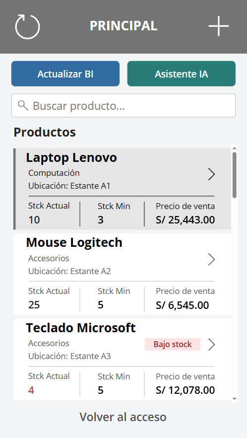
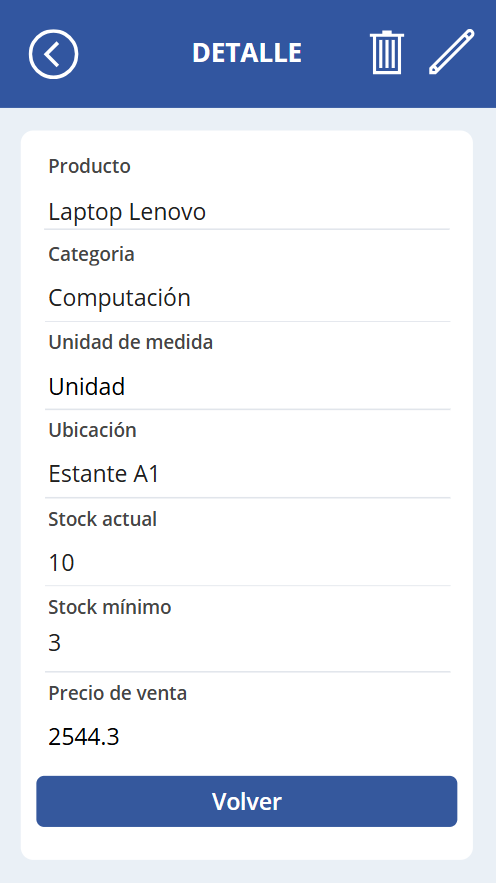
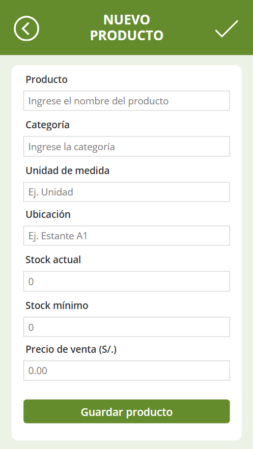
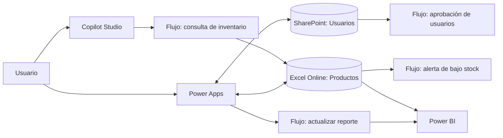
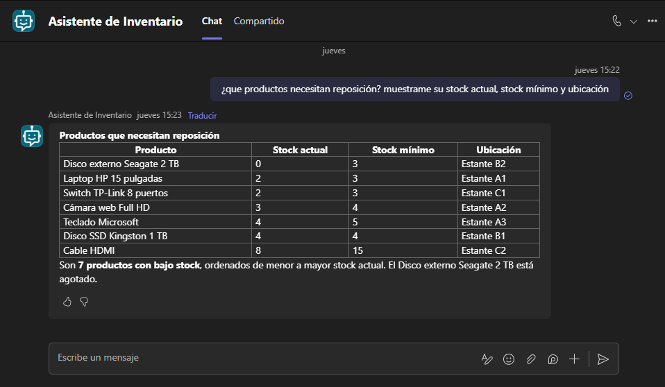
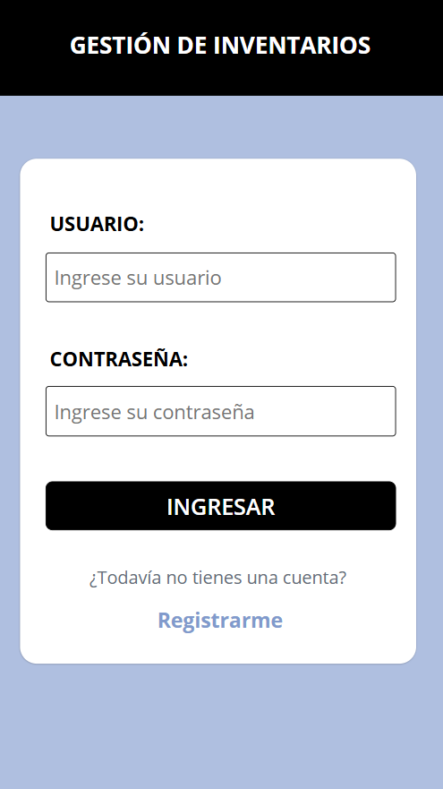
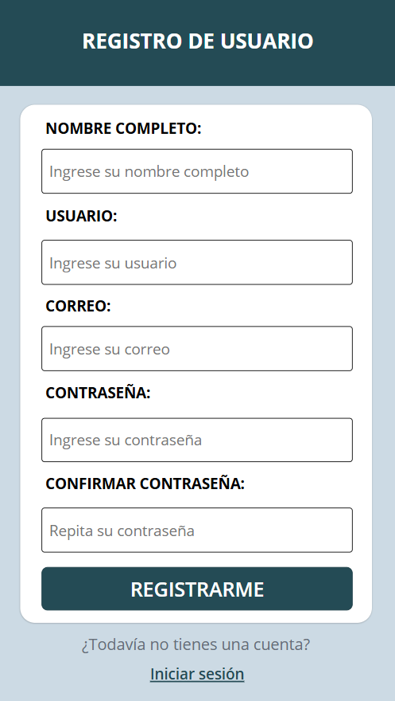
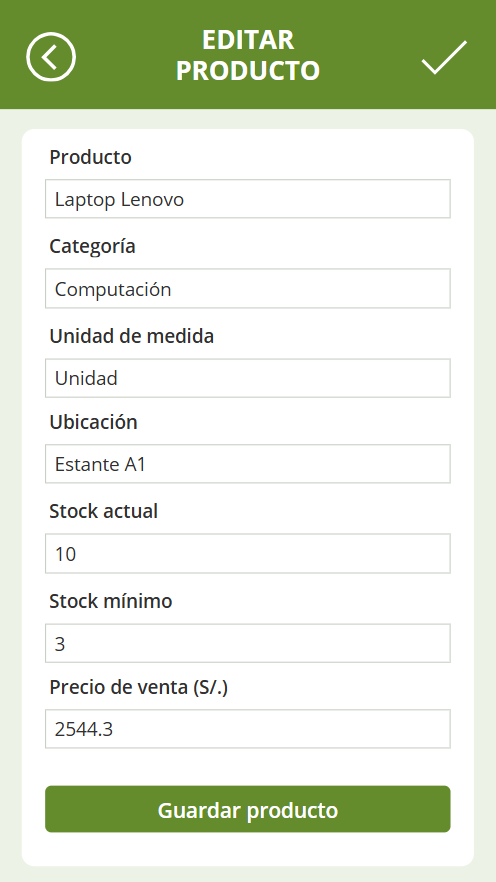

# AppInventory | Gestión de inventarios con Power Platform

Proyecto personal desarrollado para llevar a la práctica la integración de **Power Apps, Power Automate, Power BI y Copilot Studio** en un proceso de gestión de inventarios.

La solución permite consultar y administrar productos, identificar existencias que requieren reposición, gestionar solicitudes de usuarios, actualizar un reporte y consultar el inventario mediante un asistente conversacional.

> **Estado:** versión de demostración y aprendizaje. Las imágenes muestran la aplicación en funcionamiento en su entorno original. Este repositorio publica documentación, código de referencia y datos de ejemplo anonimizados; **no** incluye conexiones activas ni exportaciones privadas listas para importar.

## Vista general

<p align="center">
  
  
  
</p>

## Funcionalidades implementadas

| Componente | Funcionalidades |
| --- | --- |
| **Power Apps** | Inicio de sesión y registro de usuarios; visualización, búsqueda, registro, edición y eliminación con confirmación de productos; consulta de existencias y stock mínimo. |
| **Power Automate** | Aprobación de solicitudes de registro; alertas diarias de stock bajo por correo; actualización del conjunto de datos de Power BI desde la aplicación; consulta de productos utilizada por el asistente. |
| **Power BI** | Resumen de unidades disponibles, productos y artículos con bajo stock; gráficos por categoría y estado; tabla de artículos que requieren reposición. |
| **Copilot Studio** | Asistente conversacional que consulta productos mediante un flujo de Power Automate y responde sobre existencias, precios y ubicaciones. |

## Arquitectura de la solución



El libro de Excel incluido es una **muestra local anonimizada**. En el entorno original las automatizaciones dependen de conexiones configuradas en Microsoft Power Platform.

## Dashboard y asistente




En el conjunto de datos de demostración hay **16 productos**, **163 unidades** en total y **7 productos que requieren reposición**. Para clasificar el stock bajo se utiliza el criterio **StockActual ≤ StockMinimo**, incluyendo los productos que están exactamente en el mínimo.

## Más pantallas de la aplicación

<p align="center">
  
  
  
</p>

## Organización del repositorio

```text
app-inventory-power-platform/
├── README.md
├── .gitignore
├── data/
│   └── inventario-demo.xlsx
├── power-apps/
│   ├── README.md
│   └── source/                  # Fórmulas y definición de pantallas (.pa.yaml)
├── power-automate/
│   ├── README.md
│   └── definitions/             # Definiciones JSON redactadas de 4 flujos
├── power-bi/
│   ├── README.md
│   └── report-definition/       # Definición visual extraída del .pbix
├── copilot-studio/
│   └── README.md
└── docs/
    ├── arquitectura.md
    ├── seguridad.md
    └── images/                   # 8 capturas de la solución
```

## Cómo explorar el proyecto

1. Abre las capturas de `docs/images/` para conocer el funcionamiento y el diseño.
2. Revisa `power-apps/source/` para ver las pantallas y fórmulas originales en formato legible **Power Fx / YAML**.
3. Consulta `power-automate/definitions/` para entender los cuatro flujos. Se sustituyeron los datos privados de conexión por valores ficticios; **estos JSON no son paquetes de importación**.
4. Abre `data/inventario-demo.xlsx` para explorar productos de prueba y el esquema de datos.
5. Revisa `power-bi/report-definition/` para inspeccionar la estructura de los visuales y `docs/images/07-dashboard-power-bi.png` para ver el resultado.

### ¿Se puede importar e instalar directamente?

No desde este repositorio, porque la versión pública excluye los **paquetes originales de Power Apps y Power Automate**, así como el **archivo Power BI `.pbix`**, ya que contienen referencias del entorno original, entre ellas rutas de SharePoint y direcciones de correo. Para replicar la solución se deben crear conexiones propias y disponer de los paquetes exportados desde un entorno autorizado.

## Seguridad y alcance

- Proyecto educativo / demostrativo, no diseñado como solución de inventarios para producción.
- La implementación de acceso de prueba utiliza un campo de contraseña en su origen de datos. **No debe utilizarse como sistema de autenticación de producción**; para un despliegue real se recomienda Microsoft Entra ID y permisos gestionados por la plataforma.
- El Excel público contiene un usuario ficticio sin contraseña operativa. No incluye las credenciales del archivo original.
- Las definiciones públicas de flujos están redactadas y no contienen conexiones funcionales.
- Revisa [consideraciones de seguridad](docs/seguridad.md) antes de añadir archivos exportados o nuevas capturas.

## Aprendizajes y próximos pasos

El principal aprendizaje fue **integrar distintas herramientas como partes de un mismo proceso**, además de mejorar fórmulas, validaciones, navegación, mensajes y presentación de la información. Entre las mejoras posibles están reforzar la autenticación, ampliar la trazabilidad de movimientos, administrar roles y preparar una versión portable a otro entorno.

---

**Autor:** Juan Tafur  
**Tipo:** Proyecto personal de Microsoft Power Platform  
**Propósito:** Documentar y compartir el desarrollo, las pruebas y las integraciones realizadas.
