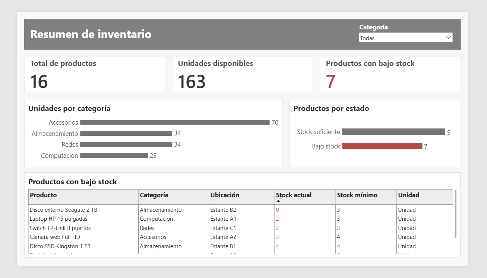

# Power BI — Reporte de inventario

En `report-definition/` se encuentra la definición **JSON del diseño y los visuales** extraída del `.pbix` original. La estructura permite examinar componentes del reporte sin publicar el modelo de datos ni sus conexiones de origen.

El reporte muestra un resumen de productos y unidades disponibles, productos con bajo stock, unidades por categoría, productos por estado y una tabla detallada de reposición.

**El archivo `.pbix` original no está incluido en esta versión pública** porque puede contener referencias al origen de datos privado. El JSON no reemplaza al `.pbix` ni constituye por sí solo un proyecto `.pbip` importable. Para añadir una versión funcional, primero se debe abrir el original, modificar y revisar los orígenes de datos, quitar información de cuenta y comprobar el contenido antes de publicarla.
